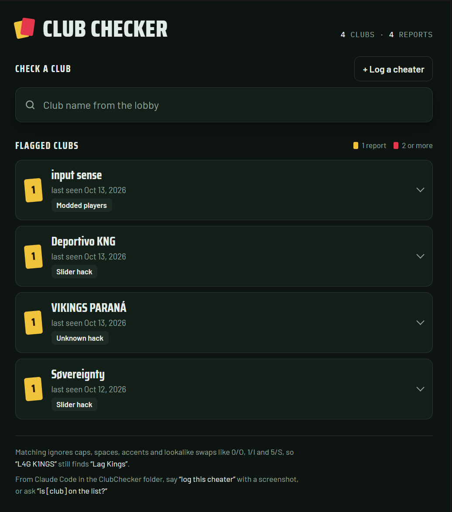

# Club Checker

A shared cheater log for FC 27 Pro Clubs. Check any club before kick-off and log cheaters as you meet them, from your phone or from Claude Code.

**Open it: https://dfirestone21.github.io/ClubChecker/**



## How it works

- **The page** is a plain web page on GitHub Pages. Anyone with the link can search clubs, see each report with its screenshots and gamertags, and log a new cheater. No account or sign-in needed. A club with one report gets a yellow card; two or more get a red card.
- **The data** lives in a free [Supabase](https://supabase.com) database (reports) and storage bucket (screenshots). Visitors can read and add reports but can't edit or delete them.
- **Two Claude Code skills** use the same data:
  - **`register-cheater`** reads the club name, score and date from a screenshot (or takes a typed name), asks what the cheat was if you didn't say, and saves the report with the screenshot attached.
  - **`check-cheater`** tells you whether a club is on the list, from a typed name or a lobby screenshot, along with what they did, how often and which players.

Matching is forgiving: it ignores caps, spaces and accents, treats lookalikes (0/O, 1/I/l, 5/S, ø/o) as the same letter, and links clubs that renamed through their old names.

## Using it

**On the page:** type a club name to check it, or tap **Log a cheater**, fill in the club name and what they did, and attach a screenshot.

**In Claude Code:** clone this repo, open a session in the folder, then call a skill or just ask:

```text
/register-cheater   the left team, they were using slider hacks (with a screenshot)
/check-cheater      is Deportivo KNG on the list?
log the latest screenshot, slider hack
are these guys legit?                                          (with a lobby screenshot)
```

Paste screenshots into the chat or drop them into `screenshots/`. Once a report is saved, its screenshots are deleted from that folder; the page keeps its own copy.

Python 3 is required for the skills, with no extra packages.

## Fixing or removing a report

Reports can't be edited or deleted from the page or the skills. The project owner does it in the Supabase dashboard: **Table Editor → reports** for the report, **Storage → screenshots** for its images.

Free Supabase projects pause after about a week without database activity. A scheduled GitHub workflow ([`keep-alive.yml`](.github/workflows/keep-alive.yml)) queries the database twice a day to prevent that. GitHub switches off scheduled workflows in public repos after 60 days without a commit (it emails a warning first); re-enable it from the repo's **Actions** tab. If the page ever says it couldn't load the log, restore the project from the Supabase dashboard.

## Run your own

1. Fork or clone the repo.
2. Create a free Supabase project and run [`supabase/setup.sql`](supabase/setup.sql) in its SQL Editor.
3. In `config.json`, set `supabaseUrl` and `supabaseKey` (the project's **publishable** key, never the secret one), your own club names in `ownClubs`, and `pageUrl`.
4. Turn on GitHub Pages for the repo (Settings → Pages → deploy from the `main` branch, root folder).

## Project layout

```text
index.html                         the page (served by GitHub Pages)
config.json                        page URL, Supabase connection, your club names
supabase/setup.sql                 database table, permissions and screenshot bucket
.github/workflows/keep-alive.yml   twice-daily database query so Supabase doesn't pause
tools/registry.py                  name matching, checking and saving reports
.claude/skills/register-cheater/   skill: log a cheater
.claude/skills/check-cheater/      skill: check a club
```
